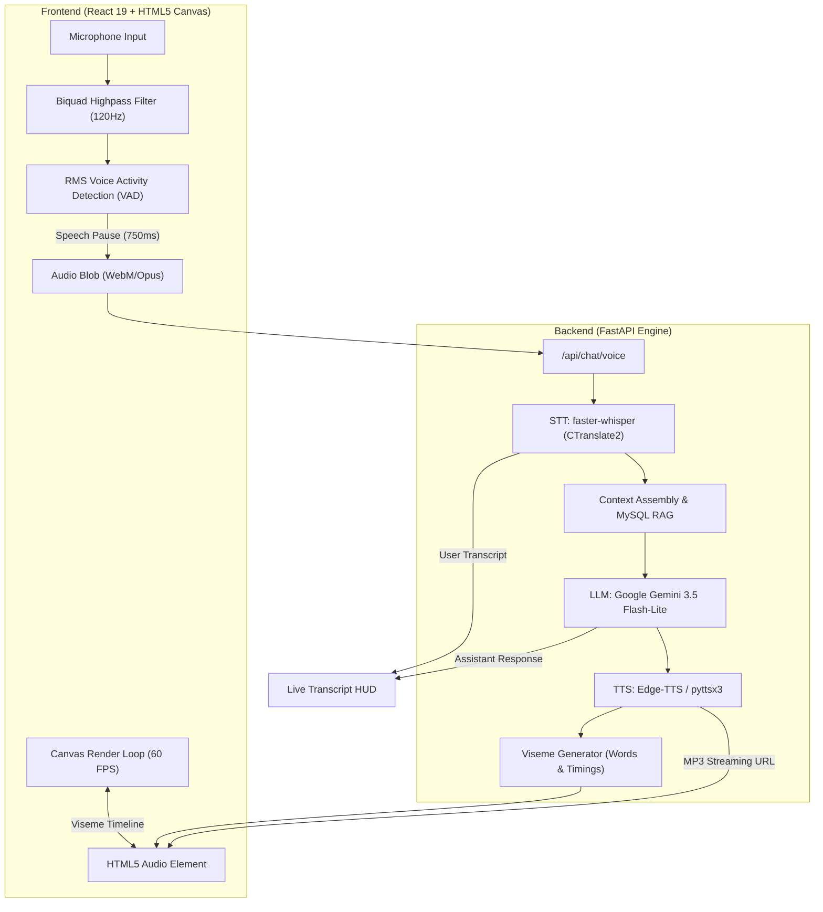

# 🎙️ Real-Time Conversational AI Avatar

[](https://www.python.org/)
[](https://fastapi.tiangolo.com/)
[](https://react.dev/)
[](https://vitejs.dev/)
[](https://ai.google.dev/)
[](https://developer.mozilla.org/en-US/docs/Web/API/Web_Audio_API)
[](https://www.mysql.com/)
[](https://opensource.org/licenses/MIT)

An end-to-end full-stack conversational AI avatar platform featuring hands-free speech-to-speech interaction, dynamic client-side Voice Activity Detection (VAD), sub-second LLM streaming, neural text-to-speech, and real-time facial viseme lip-synchronization rendered on an HTML5 canvas.

---

## 🌟 Key Highlights

- **🎙️ Zero-Click Full-Duplex Voice Mode**: Built-in Web Audio API Voice Activity Detection (VAD) equipped with a 120Hz high-pass Biquad filter to eliminate room rumble, adaptive noise-floor calibration, and dynamic peak-energy thresholding. It automatically starts listening, detects speech pauses (~750ms), and submits without pressing any buttons.
- **👄 Synchronized Viseme Lip-Sync**: Server generates time-coded viseme blendshape timelines alongside neural speech audio, enabling frame-accurate mouth movements and natural micro-expressions (blinking, eye saccades, breathing) in real time.
- **⚡ Ultra-Low Latency Pipeline**: Sub-2s end-to-end response times powered by `gemini-3.5-flash-lite`, local `faster-whisper` speech transcription, and streaming `edge-tts`.
- **🎭 Dual Interactive Avatars**:
  - **Eve**: 2D layered anime avatar with animated eyes, pupil glance saccades, idle sway/breathing, and phoneme-based lip-sync.
  - **Steve**: Minimalist particle-aura visualizer featuring ambient orb resonance and reactive frequency waveforms.
- **💬 Real-Time Live Transcript**: Live HUD sidebar tracking user audio transcripts and avatar replies with auto-scroll and speaker badges.
- **📊 Production Telemetry**: Turn-by-turn latency metrics (`stt_latency_ms`, `llm_latency_ms`, `tts_latency_ms`, `total_latency_ms`) and token usage recorded to MySQL.
- **🚀 One-Click Windows Launcher**: Automatic port collision resolution and simultaneous launch of FastAPI and Vite with browser launch (`run.bat` / `run.ps1`).

---

## 🏗️ Architecture Flow



---

## 📁 Repository Structure

```
conversational-avatar/
├── backend/                             # FastAPI Backend Engine
│   ├── app/
│   │   ├── main.py                      # REST API routing & static asset mount
│   │   ├── agent.py                     # LiveKit real-time voice pipeline agent
│   │   ├── config.py                    # Pydantic environment configuration
│   │   ├── database.py                  # SQLAlchemy session & MySQL connection
│   │   ├── schemas.py                   # Pydantic request/response models
│   │   ├── models/                      # SQLAlchemy ORM models
│   │   ├── routes/                      # REST endpoints (chat, voice, users, sessions)
│   │   │   ├── chat.py                  # Core speech-to-speech & text pipelines
│   │   │   ├── team_api.py              # Frontend turn orchestration & telemetry
│   │   │   └── users.py                 # User authentication & session management
│   │   └── services/                    # Core microservices
│   │       ├── gemini_service.py        # Gemini API wrapper with automated model failover
│   │       ├── stt_service.py           # faster-whisper transcription
│   │       ├── tts_service.py           # Edge-TTS voice synthesis & viseme extraction
│   │       └── context_service.py       # Conversation history & full-text MySQL RAG
│   ├── requirements.txt                 # Backend Python dependencies
│   └── .env.example                     # Environment template
│
├── conversational-avatar-frontend/       # React 19 + Vite Frontend
│   ├── public/                          # Static sprites, layers, and audio assets
│   │   ├── eve-layers/                  # Eve avatar layers (eyes, mouth, body)
│   │   └── office_bg_*.png              # Avatar background environments
│   ├── src/
│   │   ├── pages/                       # Route pages
│   │   │   ├── EvePage.jsx              # Eve avatar, Web Audio VAD, canvas lip-sync
│   │   │   ├── StevePage.jsx            # Steve avatar particle visualizer
│   │   │   ├── SelectPage.jsx           # Avatar selection screen
│   │   │   └── LoginPage.jsx            # Authentication interface
│   │   ├── App.jsx                      # Routing & navigation setup
│   │   └── main.jsx                     # Application bootstrap
│   ├── package.json                     # Frontend dependencies
│   └── vite.config.js                   # Vite configuration & backend proxy
│
├── database/                            # MySQL Schema & Seeds
│   ├── schema.sql                       # Database tables, foreign keys & indexes
│   └── seed.sql                         # Knowledge base demo seed data
│
├── run.bat                              # One-click Windows launch script
├── stop.bat                             # One-click Windows shutdown script
├── run.ps1                              # One-click PowerShell launch script
└── README.md                            # Project documentation
```

---

## 🛠️ Tech Stack

| Domain | Technology | Purpose |
|---|---|---|
| **Frontend Framework** | React 19, Vite 8 | Ultra-fast UI rendering and module bundling |
| **Avatar Rendering** | HTML5 Canvas 2D | High-performance 60 FPS sprite & viseme blending |
| **Voice Activity Detection** | Web Audio API | RMS time-domain energy tracking with Biquad highpass filter |
| **Backend Framework** | FastAPI, Uvicorn | Asynchronous Python REST API and media serving |
| **Large Language Model** | Google Gemini 3.5 Flash-Lite | Sub-second generative response engine |
| **Speech-to-Text (STT)** | faster-whisper (CTranslate2) | Accurate, local, zero-cost speech transcription |
| **Text-to-Speech (TTS)** | Microsoft Edge Neural TTS | High-fidelity studio voice synthesis |
| **Viseme Generation** | Custom Phoneme Mapper | Time-aligned blendshape mouth frames |
| **Database & Telemetry** | MySQL 8.0, SQLAlchemy | Session logs, system latency metrics, RAG knowledge base |

---

## 🚀 Quickstart Guide

### Option 1: One-Click Run (Windows)

1. Make sure **Python 3.10+** and **Node.js 18+** are installed and added to your `PATH`.
2. Configure your `backend/.env` (see [Environment Setup](#-environment-setup) below).
3. Double-click **`run.bat`** (or execute `.\run.ps1` in PowerShell).
   - Automatically kills any conflicting stale processes on ports `8000` and `5173`.
   - Starts the FastAPI backend on `http://127.0.0.1:8000`.
   - Starts the Vite frontend on `http://localhost:5173`.
   - Automatically opens your default web browser to the application.
4. To stop both services, double-click **`stop.bat`**.

---

### Option 2: Manual Setup

#### 1. Database Setup
Ensure MySQL is running, then load the schema:
```bash
mysql -u root -p < database/schema.sql
mysql -u root -p < database/seed.sql   # Optional seed knowledge base data
```
Create a dedicated user:
```sql
CREATE USER 'avatar_app'@'localhost' IDENTIFIED BY 'changeme';
GRANT ALL PRIVILEGES ON ai_avatar.* TO 'avatar_app'@'localhost';
FLUSH PRIVILEGES;
```

#### 2. Backend Setup
```bash
cd backend
python -m venv venv

# Windows
venv\Scripts\activate
# Linux/macOS
source venv/bin/activate

pip install -r requirements.txt
cp .env.example .env
```
Edit `backend/.env` with your Gemini API key from [Google AI Studio](https://aistudio.google.com/apikey):
```env
GEMINI_API_KEY=your_gemini_api_key_here
GEMINI_MODEL=gemini-3.5-flash-lite
```
Start the backend:
```bash
uvicorn app.main:app --reload --host 127.0.0.1 --port 8000
```

#### 3. Frontend Setup
In a new terminal window:
```bash
cd conversational-avatar-frontend
npm install
npm run dev
```
Navigate to `http://localhost:5173` in your browser.

---

## ⚙️ Environment Configuration

Copy `backend/.env.example` to `backend/.env` and update values:

```ini
# --- MySQL Database ---
MYSQL_HOST=localhost
MYSQL_PORT=3306
MYSQL_USER=avatar_app
MYSQL_PASSWORD=changeme
MYSQL_DATABASE=ai_avatar

# --- Google Gemini API ---
GEMINI_API_KEY=your_gemini_api_key_here
GEMINI_MODEL=gemini-3.5-flash-lite

# --- Speech Pipeline ---
STT_MODEL_SIZE=base
STT_DEVICE=cpu
STT_COMPUTE_TYPE=int8
TTS_ENGINE=edge-tts
TTS_VOICE=en-US-JennyNeural
AUDIO_OUTPUT_DIR=static/audio
```

---

## 📡 REST API Reference

| Method | Endpoint | Description |
|---|---|---|
| `POST` | `/api/chat/voice` | Primary voice conversational turn: takes audio recording (`multipart/form-data`), returns user transcript, reply text, MP3 URL, base64 audio, and visemes array |
| `POST` | `/api/chat` | Text turn: takes message, returns LLM reply, audio URL, and visemes |
| `POST` | `/api/chat/stt` | Transcribes an uploaded audio file using `faster-whisper` |
| `POST` | `/api/chat/tts` | Synthesizes speech from text and returns audio URL + viseme timeline |
| `GET` | `/api/chat/voices` | Returns all available neural TTS voices |
| `GET` | `/api/health` | Service health status and active route endpoints |

---

## 📊 Telemetry & Latency Monitoring

Every interaction automatically logs latency telemetry into MySQL's `system_metrics` table for production performance monitoring:

```sql
SELECT 
    log_id,
    stt_latency_ms,
    llm_latency_ms,
    tts_latency_ms,
    total_latency_ms,
    created_at 
FROM system_metrics 
ORDER BY created_at DESC 
LIMIT 5;
```

---

## 🛡️ License

This project is licensed under the [MIT License](LICENSE).
